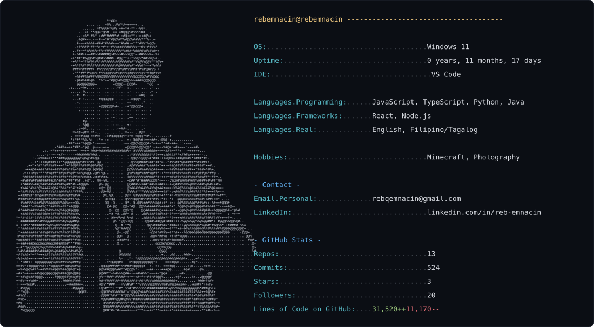
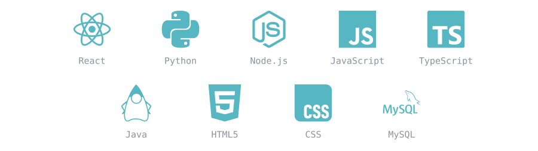
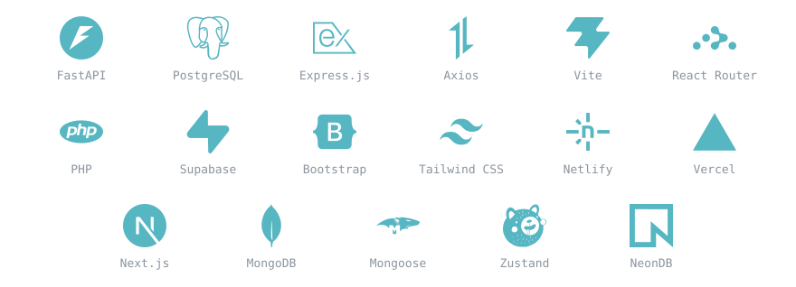

<!-- This image is generated automatically by generate_card.py + the
     GitHub Action in .github/workflows/update-card.yml. Once that's
     set up (see the setup note inside update-card.yml), this line
     will always show your live stats — you never edit it by hand. -->

 

<!-- Icons are drawn in tech-stack.svg (same folder as this README). -->

 

<!-- Icons are drawn in exploring.svg (same folder as this README). -->

 

 
